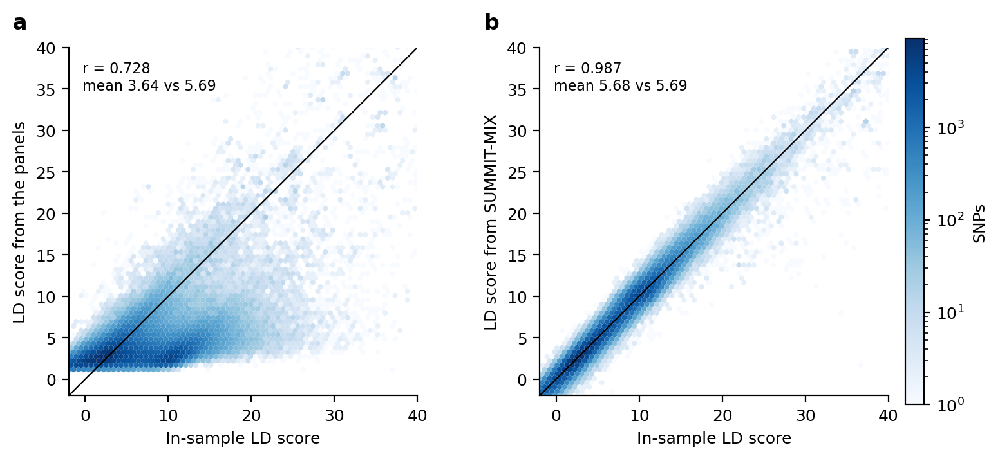

# Admixed cohorts without in-sample LD (SUMMIT-MIX)

SUMMIT fits heritability and genetic correlation from summary statistics and LD scores. For an admixed GWAS sample,
such as African American or Latino participants, the LD scores should come from the sample itself, because admixture
creates LD that no reference panel has. When the sample's genotypes are not available, SUMMIT-MIX
(`summit admixed-ld`) builds the LD scores from reference panels of the source populations, the GWAS summary
statistics and a release of aggregates that the cohort makes once from its genotypes (**curve mode**). Without a
release, a published admixture date takes its place (**date mode**). The output is an ordinary LD-score file that
`summit --h2` and `summit --rg` read.

Both quick starts need the same reference, built once from public panels of the sources (see
[The reference](SUMMIT-MIX-details.md#the-reference)):

```bash
summit admixed-ld reference --panel ref/afr --panel ref/eur --names AFR,EUR \
  --genetic-map maps/genetic_map_chr{chr}_combined_b37.txt --threads 16 --out ref/afr_eur
summit admixed-ld clean-panels --ref ref/afr_eur --panel ref/afr --panel ref/eur --names AFR,EUR \
  --threads 4 --out ref/afr_eur_clean
```

Each `--panel` is a PLINK prefix of unadmixed people from one source, in the genome build of the cohort; the last name
is the baseline source. [SUMMIT-MIX details](SUMMIT-MIX-details.md) defines the terms used below and has every option.

## Quick start for the cohort

The cohort runs one command where its genotypes are. Run it once, on everyone who enters any GWAS of the cohort, with
the covariates that every GWAS uses, principal components included.

```bash
summit admixed-ld release --geno cohort --ref ref/afr_eur_clean --keep gwas_people.txt \
  --covar gwas_covariates.txt --relative-pairs related_pairs.tsv --threads 8 --out release
```

`--relative-pairs` lists related pairs in a file with columns IID1 and IID2, for example pairs with relatedness above
0.0442 in a GRM. The release takes 10 to 20 minutes on 8 cores for 3,800 to 6,100 people at array density.

**What to share.** The folder `release/` holds only aggregates. They are the curve (the covariance of local ancestry by
genetic distance), the background term, the cell matrix, the sample statistic and the eight MAF and LD bins of the fit,
with `README.txt` and `release.json`, which list each file and the counts of people, SNPs and related pairs. No file
has a row about a person. Share the whole folder, subject to the cohort's own rules on small counts.

**What never to share.** The genotypes, the phenotypes, the files given to `--keep`, `--covar` and `--relative-pairs`,
and any per-person table such as ancestry estimates or principal components.

**The 50-person rule.** A sample statistic needs at least 50 people, and `release` and `sample-factors` refuse fewer.
For a trait measured in less than 85% of the release's people, the cohort may also release the statistic of that
trait's people ([Traits measured in part of the cohort](SUMMIT-MIX-details.md#traits-measured-in-part-of-the-cohort)).
Do not release it when the trait's people, or the release's people without the trait, number fewer than 50, because
two statistics whose samples differ by a few people describe those people.

## Quick start for the analyst

The analyst needs the release, the same reference and the summary statistics (SUMMIT format with `BETA`, `SE`, `N`,
`COV_RANK`, `CHR` and `BP`; least-squares or linear-probability statistics). One `compose` serves every trait of the
cohort.

```bash
summit admixed-ld compose --ref ref/afr_eur_clean --release release --sumstats gwas/ \
  --annot release/cohort.bins8.annot.gz --out ld/cohort
summit --h2 gwas/ --ldscores ld/cohort --annot release/cohort.bins8.annot.gz --out results/h2
summit --rg gwas/height.tsv,gwas/bmi.tsv --ldscores ld/cohort --annot release/cohort.bins8.annot.gz \
  --pheno-rg pheno/height.txt,pheno/bmi.txt --pheno-rg-cov gwas_covariates.txt,gwas_covariates.txt \
  --keep-ambiguous --out results/rg
```

- Compose reads every file of `gwas/` and logs a short plan before it starts. Read the warnings in
  `ld/cohort.compose.log` and the `flags` in `ld/cohort.admixed_ld.json`; the
  [flags table](SUMMIT-MIX-details.md#flags) says which are expected with one release.
- When the traits' sample sizes differ, compose writes one LD-score file per sample size and lists them in
  `ld/cohort.n_groups.tsv`, which `summit --h2` reads to fit each trait with its own file.
- `--keep-ambiguous` keeps A/T and C/G SNPs, which two GWAS of the same people need not align. `--pheno-rg` and
  `--pheno-rg-cov` give the phenotypes and covariates of the two GWAS, where they are at hand, for the covariance of the
  two samples; without them SUMMIT estimates it from the summary statistics.
- `release/cohort.bins8.annot.gz` holds the eight MAF and LD bins. In samples of a few thousand people or fewer the
  heritability of eight bins is poorly determined, and the two MAF classes of `release/cohort.maf2.annot.gz` are the
  more stable readout.

Date mode replaces `--release release` with a published date, for example `--admixture-generations 6` for African
American groups, and needs nothing from the cohort. Without the cohort's bins, fit two MAF classes cut at 0.05
([The MAF and LD bins](SUMMIT-MIX-details.md#the-maf-and-ld-bins)).

To try both quick starts on simulated data, run `bash example/admixed_ld_release.sh` from the repository root.
`bash example/admixed_ld.sh` runs the separate steps, date mode, in-sample LD scores for comparison and fine-mapping.
Each takes about a minute.

## How it works

LD in an admixed sample has two parts.

- **LD within each source.** Nearby SNPs are correlated within each source population. In an admixed person this LD
  survives on stretches of the genome inherited from one source. SUMMIT-MIX takes it from the panels, weighted by the
  sample's ancestry.
- **Admixture LD.** Local ancestry changes slowly along the genome, so a person's ancestry at two points tens of
  centimorgans (cM) apart is still correlated. SNPs whose allele frequencies differ between the sources are therefore
  correlated over long distances. Its size depends on the frequency differences, which come from the panels, and on how
  fast the correlation of local ancestry decays with distance.


(a) The covariance of local ancestry at two points of the genome, by their genetic distance, in an admixed UK Biobank
sample of 3,781 people (after adjusting for the GWAS's principal components). Curve mode measures it in the cohort.
Date mode assumes the decay that a single admixture event 6 generations ago would give. (b) The LD score of SNPs on
chromosome 22, averaged over SNPs, counting only partners up to the distance on the x axis. The panels' LD is complete
within about 1 cM. Admixture LD keeps adding to the LD score out to about 30 cM and here raises it by two thirds.
Reference LD scores, which sum over partners within 1 cM or so, miss it.

Two more pieces complete the picture.

- The GWAS standard errors depend on each SNP's variance in the sample, which in turn depends on the sample's mean
  ancestry and on the variance of local ancestry. SUMMIT-MIX reads both from the summary statistics.
- A GWAS sample also carries small LD terms of its own. The same-person term comes from each person's genotype variance
  following their ancestry, and the background term from people who share segments of the genome, relatives included.
  The release measures both, the first through the sample statistic. Date mode composes the first under random mating
  and leaves out the second.

### Curve mode or date mode?

| | Curve mode | Date mode |
|---|---|---|
| Needs from the cohort | one run of `summit admixed-ld release` where the genotypes are | nothing |
| What the cohort shares | aggregates only, no row describes a person | nothing |
| Needs from elsewhere | panels, summary statistics | panels, summary statistics, a published admixture date |
| Heritability ratio in All of Us participants of African ancestry | 0.997 to 1.014 | 0.92 to 0.98 (6 generations) |
| Heritability ratio in All of Us participants of Admixed American ancestry | 1.007 to 1.008 | 1.006 to 1.011 (11 generations) |

Use curve mode whenever the cohort can run one command. Date mode depends on the date. In a multiracial group of 2,248
All of Us participants it gave 0.979 to 0.999 at the published date of 6 generations and 0.57 to 0.60 at 1 generation
(two MAF classes).

## Does it work?

The heritability ratio is the heritability summed over traits with composed LD scores divided by the sum with in-sample
LD scores, from the same summary statistics. We developed the method in two UK Biobank samples of African ancestry (an
admixed sample of 3,781 people and a sample of 6,111 that also includes unadmixed people, 405,807 array SNPs, 32 traits)
and tested it in All of Us.



LD scores of each SNP in the admixed UK Biobank sample of 3,781 people. (a) LD scores from the African and European
panels, mixed in the sample's proportions, miss the admixture LD: on average 3.6 against 5.6 in the sample. (b)
SUMMIT-MIX in curve mode matches the in-sample LD scores SNP by SNP.


The heritability ratio over 32 traits, each compared with the in-sample LD scores of its own GWAS sample, with eight MAF
and LD bins. Curve mode gave 0.986 and 0.991 in the two samples, and 0.996 and 0.997 with two MAF classes. LD scores
from reference panels, including the admixed 1000 Genomes panels, gave 0.62 to 1.40, and the error changed between the
two samples. In All of Us, with each set of panels available to us, curve mode gave 0.997 to 1.014 in participants of
African ancestry and 1.007 to 1.008 in participants of Admixed American ancestry. The same panels used directly as
reference LD missed the in-sample sum by up to 63%.

## Things to check

- Use least-squares or linear-probability summary statistics. Logistic and mixed-model standard errors give a wrong
  mean ancestry; compose names traits whose values stand apart from the others.
- Make the release with the covariates of the GWAS, the same for every trait, and give every GWAS its `COV_RANK`.
  Compose takes the release's covariate rank for summary statistics without one, and logs it.
- One release serves the cohort. Compose warns when a trait's GWAS sample holds less than 85% of the release's people.
  Compose such a trait alone, with the statistic of its own people
  ([how](SUMMIT-MIX-details.md#traits-measured-in-part-of-the-cohort)). The statistic corrects the same-person term but
  not the admixture LD of the trait's people, which comes from the release's curve. In All of Us traits of participants
  of African ancestry measured in fewer than 85% of them, composed heritability was 1.6% to 3.4% high.
- If the panels and the cohort may be on different strands, add `--drop-ambiguous` to `reference`, `release` and
  `compose`. The release stops when it detects this.
- Close relatives also share environment, which composed LD scores cannot fix. Remove them before the GWAS, or see
  [Related individuals](Related-individuals.md).

## More analyses

| Analysis | Commands | Details |
|---|---|---|
| Traits measured in part of the cohort | `sample-factors --keep`, `compose --sample-factors` | [Traits measured in part of the cohort](SUMMIT-MIX-details.md#traits-measured-in-part-of-the-cohort) |
| Genetic correlation with a GWAS of a source population | `compose --cross-source EUR`, `summit --rg --ldscores-h2-1 --ldscores-h2-2` | [Cross-population LD](SUMMIT-MIX-details.md#cross-population-ld) |
| Fine-mapping with a composed LD matrix | `matrix`, `finemap-variance` | [Fine-mapping](SUMMIT-MIX-details.md#regional-ld-matrices-and-fine-mapping) |
| Correlation of effects across local ancestries | `tractor-gwas`, `tractor-sumstats`, `track-rg` | [Local ancestries](SUMMIT-MIX-details.md#correlation-of-effects-across-local-ancestries) |
| A source without a panel | `derive` | [Sources without a panel](SUMMIT-MIX-details.md#sources-without-a-panel) |
| Three or more sources | `--sources AFR,EUR,NAT` | [Compose](SUMMIT-MIX-details.md#compose) |
| The curve or the bins alone | `curve`, `bins` | [The release](SUMMIT-MIX-details.md#the-release) |

`example/admixed_ld_real_data.sh` is a template of every step for a real cohort.

## Limits

- Each source needs a panel whose LD is that of the source. A panel of a related population weakens the admixture LD.
- Fine-mapping in a sample selected on the trait (for example, cases and controls of a disease with a strong locus
  that differs between ancestries) needs in-sample LD at the loci that drive the selection. Genome-wide estimates are
  little affected.
- The track correlation depends on correct local-ancestry calls.
