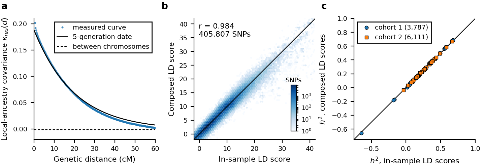

# Admixed cohorts without in-sample LD

LD scores for an admixed GWAS sample are best computed in the sample itself, with the
GWAS covariates ([LD scores](LD-scores.md#covariates-and-snp-variance-weights)). When
the genotypes are not at hand, for example for published summary statistics or a cohort
that releases only aggregates, `summit admixed-ld` composes them from three inputs:

- unadmixed panels of the two source populations, made once into a reference resource;
- the GWAS summary statistics, whose standard errors give the mean ancestry and the
  variance of local ancestry that the covariates leave;
- the decay of local-ancestry covariance with genetic distance, as the cohort's measured
  curve, a published admixture date, or a decay rate.

The sum of squared relatedness of relatives in the sample is an optional fourth input. The
output is an ordinary `.gw.ldscore.gz` file with a `V` column, which `summit --h2` and
`--rg` read unchanged.

For a runnable synthetic example, run `bash example/admixed_ld.sh` from the repository
root. It composes LD scores in two ways and fits h² with them and with in-sample LD
scores.

## Model

The composition rests on these assumptions.

1. The cohort descends from two source populations, and each person's genome is a
   mosaic of segments of one ancestry.
2. On a stretch of one ancestry with no recombination since admixture, LD between two
   SNPs is that of the source population, as measured in its panel. Recombination since
   admixture, at rate λ per cM, breaks this LD.
3. Local ancestry makes SNPs whose allele frequencies differ between the sources
   correlated over long distances. After the covariates, the covariance of local ancestry
   at distance d is κ(d), which decays with d.
4. The GWAS used least squares with the covariates of the cohort, including genotype
   PCs or global ancestry.

The covariance of the dosages of SNPs j and k after the covariates is then

```text
C(j,k) = m exp(-λ d) C_A(j,k) + (1 - m) exp(-λ d) C_E(j,k) + δ_j δ_k κ(d),
```

where m is the mean ancestry from the first source, C_A and C_E are the panel
covariances, and δ is the difference of allele frequencies between the sources. On
different chromosomes only the last term remains, with the between-chromosome value of κ.
The LD scores follow SUMMIT's definition with these covariances. They include each
person's pairing with themselves, which SUMMIT's noise correction leaves when
heterozygosity follows ancestry, and V weights from the same model.
[Methods](Methods.md) gives the in-sample definition.

Mean ancestry and κ(0) come from the standard errors. For least squares,
`N SE² + β²` is proportional to one over the dosage variance after the covariates, which
the model gives as `m v_A + (1 - m) v_E + δ² κ(0)`. A regression across SNPs without an
intercept gives both. SNPs with χ² ≥ 80 and outlying residuals are left out, and with
several traits the medians are used.

## Build the reference

```bash
summit admixed-ld reference --panel ref/afr --panel ref/eur --names AFR,EUR \
  --genetic-map maps/genetic_map_chr{chr}_combined_b37.txt --threads 16 --out ref/afr_eur
```

Each `--panel` is a PLINK 1 BED or PLINK 2 PGEN prefix of one source population. Use the
SNP set of the GWAS, or a superset of it. Variants are matched between panels by position
and alleles (`--match id` matches by ID). Strand flips are resolved except for A/T and
C/G SNPs, which are matched as listed. For each chromosome the resource stores allele
frequencies, dosage variances and the covariances of all pairs within `--window-kb`
(default 3,000 kb), with the moments that give their sampling variance. Positions in cM
come from `--genetic-map` (one file per chromosome with `{chr}`, or one file with a
chromosome column), otherwise from the CM column of the panel. Without either, 1.2 cM
per Mb is assumed with a warning.

The resource is built once and serves every cohort with these sources. The covariance
products use SUMMIT's native protected matrix products. `compose` replaces each squared
panel covariance by its unbiased estimate (a U-statistic), so small panels do not inflate
the LD scores. Rare variants are the least accurate in a small panel, since only a few
people carry them. In the check below, a random 85 of the 4,905 African-ancestry panel
members gave mean h² within 2% of the in-sample value.

## The cohort's curve

```bash
summit admixed-ld curve --geno cohort --ref ref/afr_eur --covar gwas.cov --out cohort
```

Run this where the genotypes are. It measures κ(d) as the weighted-LD curve of ROLLOFF
and ALDER on the genotypes adjusted for the GWAS covariates, in cells of `--cell-cm`
(default 0.25 cM), along with its between-chromosome value and the moments of global
ancestry. With `--relative-pairs pairs.tsv`, it also computes the relatedness of each pair
in the genotypes adjusted for the covariates and writes the sum of its square. The listed
pairs are used, selected with `--kinship-col` and `--kinship-min`. `--closure` adds every
pair within a family (connected component), which helps when the list holds only some
pairs of each family. Do not use it with a dense list of distant relatives. The relatedness after adjustment is what enters the in-sample LD scores,
and it can differ greatly from the relatedness in a pair file. In a cohort of a few
thousand people, a large family can take up a PC of its own, and first-degree pairs with
a GRM of 0.5 then have a relatedness near zero after the covariates.

Relatives share segments identical by descent, so their LD on one chromosome is far larger
than between chromosomes; for distant relatives, per SNP pair at a few cM, it is ten to
twenty times their g². The curve therefore also writes `cohort.relatedness.tsv`, the
listed pairs' products of local relatedness by distance on one chromosome (cells of
`--relatedness-cell-cm`, default 0.5 cM), and their product between chromosomes, both
net of what random unlisted pairs (`--relatedness-controls`) contribute to the same sums.
The controls remove the LD that two unrelated people share and the covariates' projection,
which the population part of the LD score already counts, and the products leave out each
SNP with itself, so the noise floor of g² (about the mean LD score over the number of SNPs
per pair) is gone too. `--no-relatedness-profile` restores the sum of g² alone.

Pair lists miss most of the relatedness that matters: distant and cryptic relatives, whose
LD per SNP pair is a property of the population rather than of the cohort's families.
`--background` measures the relatedness LD of all pairs of people without a list, from the
cross-person LD among the least differentiated SNPs (`--background-quantile`, default the
lowest fifth of the source contrast), less its admixture part and SUMMIT's null, by
distance and between chromosomes (`cohort.background.tsv`). Beyond a few cM this is what
relatives add; closer, the same products also hold within-source LD. The outputs,
`cohort.curve.tsv`, `cohort.curve.json` and these tables, hold aggregates only and can be
released with the summary statistics.

## Compose the LD scores

```bash
summit admixed-ld compose --ref ref/afr_eur --sumstats gwas/ --annot annot.tsv.gz \
  --curve cohort --out ld/cohort
```

`--sumstats` takes SUMMIT summary statistics (files or a directory) with `BETA`, `SE`
and `N`. Variants are matched by `CHR` and `BP`; if the summary statistics lack them,
give the GWAS variant table with `--snps` (BIM, PVAR, or a table with SNP CHR BP A1 A2).
`--annot` is the annotation of the fit, such as MAF/LD bins.

The decay is given in one of three ways.

| Option | Decay |
|---|---|
| `--curve PREFIX` | the cohort's measured curve; recommended |
| `--admixture-generations T` | a published admixture date; λ = T/100 per cM |
| `--decay-per-cm λ` | a decay rate per cM |

With a date or a rate, κ(d) is `far + (κ(0) - far) exp(-λ d)`, where
`far = -2 κ(0) / (λ G)` is the constant that adjustment for each person's realized
ancestry leaves and G is the genetic length of the genome. The SD of global ancestry
enters only the term of each person's pairing with themselves. It comes from the curve,
from `--ancestry-sd`, or defaults to 0.12. `--mean-ancestry` and `--kappa0` replace the
values from the standard errors. `--relatedness curve` adds the relatives' part of the
LD scores from the curve: B between chromosomes and φ(d) along each chromosome, inside the
reference window too. With a curve made with `--background`, the term is the measured LD
of all pairs from `--background-min-cm` (default 3) on and between chromosomes, smoothed as
a sum of decaying exponentials, and the listed pairs' profile below it, where the panels'
own covariances already hold their populations' background relatedness
(`--background-window flat` adds the unlisted part there as well). `--relatedness uniform`
adds the curve's sum of g² to every SNP pair, as before 5 Nov 2026, and `--relatedness X`
gives that sum directly.

The outputs are `ld/cohort.gw.ldscore.gz`, `ld/cohort.gw.M` and
`ld/cohort.admixed_ld.json`, which records every parameter used. Fit as usual:

```bash
summit --h2 gwas/ --ldscores ld/cohort.gw.ldscore.gz --annot annot.tsv.gz --out results/h2
```

## Accuracy and limits



(a) The curve measured in cohort 1, the kernel from an admixture date of 5 generations,
and the curve's between-chromosome value. (b) Composed LD scores, with the curve and the
relatives' term, against in-sample LD scores of the same SNPs in cohort 1, summed over
the eight classes. (c) h² of 32 traits fitted with composed and with in-sample LD scores,
from the same summary statistics.

We compared composed with in-sample LD scores in two cohorts of admixed UK Biobank
participants of African and European ancestry (3,787 and 6,111 people, mean African
ancestry 0.61 and 0.76), with 32 traits, 405,807 array SNPs and eight MAF/LD classes. The
references were panels of African-ancestry (4,905 and 2,452 people) and white British
(12,148) participants outside the cohorts. With the curve and the relatives' term, mean h²
over traits was 0.8% and 1.1% higher than with in-sample LD scores. The mean absolute
difference was 0.03 standard errors, and standard errors were within 1%. Without the
relatives' term the differences were 1.7% and 1.4%. With an admixture date of 5
generations (the decay that the curves measured) in place of the curve, and without the
relatives' term, they were 1.9% and 3.5%.

On 16 cores, the reference took about 18 minutes for 17,000 panel members. The curve took
about a minute for 3,787 people, and the composition about 90 seconds, most of it spent
reading the 32 summary-statistic files.

The model covers two-way admixture. It does not cover three or more sources, or panels
whose LD differs from that of the cohort's sources. The relatives' term covers the LD
scores only. Close relatives also share environment, which enters the summary statistics
themselves, so prune them before the GWAS or use [Related individuals](Related-individuals.md)
with in-sample LD scores. Resource size grows with the number of SNP pairs within the
window. For about 400,000 array SNPs and a 3,000 kb window it is about 4 GB for two
sources.
