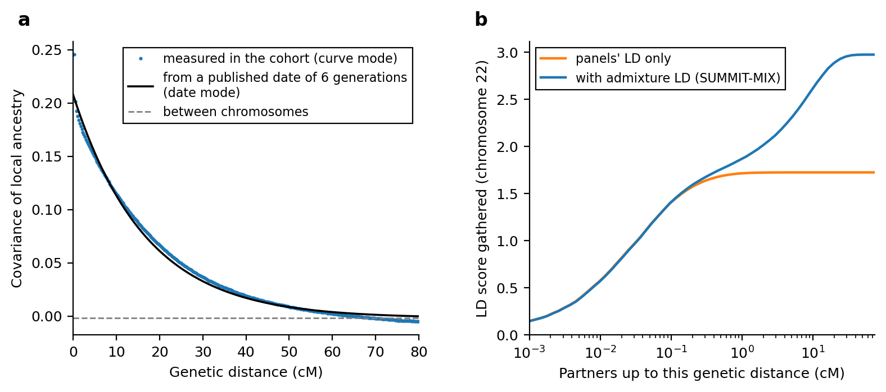
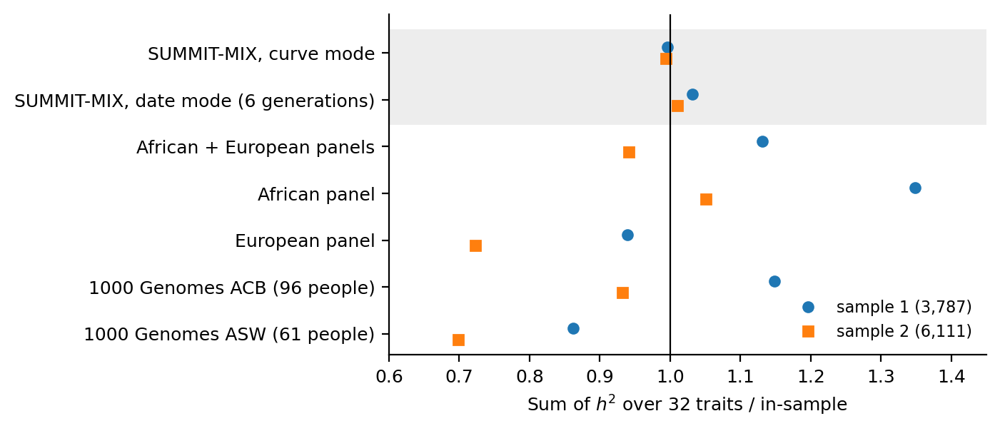

# Admixed cohorts without in-sample LD (SUMMIT-MIX)

SUMMIT fits heritability and genetic correlation from summary statistics and LD scores. For an admixed GWAS sample,
such as African American or Latino participants, the LD scores should come from the sample itself, because admixture
creates LD that no reference panel has. When the sample's genotypes are not available, SUMMIT-MIX
(`summit admixed-ld`) builds the LD scores from three inputs:

- reference panels of the source populations, for example an African and a European panel;
- the GWAS summary statistics;
- a short summary that the cohort computes once from its genotypes (**curve mode**, recommended), or a published
  admixture date (**date mode**) when only summary statistics exist.

The output is an ordinary LD-score file that `summit --h2` and `summit --rg` read as usual. The same approach gives
regional LD matrices for fine-mapping and the correlation of effects across local ancestries.

To try it, run `bash example/admixed_ld.sh` from the repository root. It runs every step on simulated data in about a
minute. [SUMMIT-MIX details](SUMMIT-MIX-details.md) has the model, every option and the checks.

## How it works

LD in an admixed sample has two parts.

- **LD within each source.** Nearby SNPs are correlated within each source population. In an admixed person this LD
  survives on stretches of the genome inherited from one source. SUMMIT-MIX takes it from the panels, weighted by the
  sample's ancestry.
- **Admixture LD.** Local ancestry changes slowly along the genome, so a person's ancestry at two points tens of
  centimorgans (cM) apart is still correlated. SNPs whose allele frequencies differ between the sources are therefore
  correlated over long distances. Its size depends on the frequency differences, which come from the panels, and on how
  fast the correlation of local ancestry decays with distance.



(a) The covariance of local ancestry at two points of the genome, by their genetic distance, in an admixed UK Biobank
sample of 3,787 people (after adjusting for the GWAS's principal components). Curve mode measures it in the cohort.
Date mode assumes the decay that a single admixture event 6 generations ago would give. (b) The LD score of SNPs on
chromosome 22, averaged over SNPs, counting only partners up to the distance on the x axis. The panels' LD is complete
within about 1 cM. Admixture LD keeps adding to the LD score out to about 30 cM and here raises it by 70%. Reference
LD scores, which sum over partners within 1 cM or so, miss it.

Two more pieces complete the picture.

- The GWAS standard errors depend on each SNP's variance in the sample, which in turn depends on the sample's mean
  ancestry and on the variance of local ancestry. SUMMIT-MIX reads both from the summary statistics, so date mode needs
  nothing from the cohort.
- A GWAS sample also carries small LD terms of its own: from each person's ancestry, from people who share segments of
  the genome (relatives included), and from structure that the principal components leave. The cohort's curve measures
  them, the first through a small sample statistic made in the same pass. Date mode includes only the first, composed
  under random mating.

### Curve mode or date mode?

| | Curve mode | Date mode |
|---|---|---|
| Needs from the cohort | one run of `summit admixed-ld curve` where the genotypes are | nothing |
| What the cohort shares | aggregates only, no row describes a person | — |
| Needs from elsewhere | panels, summary statistics | panels, summary statistics, a published admixture date |
| Sum of h² in the UK Biobank tests | within 1% of in-sample LD scores | within 3% at a date of 6 generations |

Use curve mode whenever the cohort can run one command. Date mode depends on the date: in the same tests, dates of 5 and
7 generations moved the sum of h² by 2% to 5% either way.

## Does it work?

We composed LD scores for two admixed samples in the UK Biobank (3,787 and 6,111 people, 405,807 array SNPs, 32
traits) and compared them with LD scores computed in the samples themselves.


LD scores of each SNP in the sample of 3,787 people. (a) LD scores from the African and European panels, mixed in the
sample's proportions, miss the admixture LD: on average 3.6 against 5.7 in the sample. (b) SUMMIT-MIX in curve mode
matches the in-sample LD scores SNP by SNP.



The sum of h² over 32 traits, fitted with each set of LD scores, relative to the sum with in-sample LD scores (eight
MAF and LD bins). LD scores from reference panels, including the admixed 1000 Genomes panels, gave sums 30% too low
to 35% too high, and the error changed between the two samples. SUMMIT-MIX was within 1% in curve mode.

## Running it on real data

| Step | Command | Who runs it | Writes |
|---|---|---|---|
| 1 | `reference`, `clean-panels` | anyone, once per set of panels | a reference |
| 2 | `curve` (curve mode only) | the cohort, where the genotypes are | aggregates only |
| 3 | `compose` | anyone | LD scores |
| 4 | `summit --h2`, `--rg` | anyone | estimates |

`example/admixed_ld_real_data.sh` is a template of all steps with times and memory.

**1. The reference.** Each `--panel` is a PLINK prefix of unadmixed people from one source, in the genome build of the
cohort. The last source is the baseline. `clean-panels` removes LD that the panels' own admixture and relatives add.

```bash
summit admixed-ld reference --panel ref/afr --panel ref/eur --names AFR,EUR \
  --genetic-map maps/genetic_map_chr{chr}_combined_b37.txt --threads 16 --out ref/afr_eur
summit admixed-ld clean-panels --ref ref/afr_eur --panel ref/afr --panel ref/eur --names AFR,EUR \
  --threads 16 --out ref/afr_eur_clean
```

**2. The cohort's curve.** Run it once for the cohort, on the people of its GWAS (`--keep`) with exactly the GWAS's
covariates, principal components included (`--covar`). `--relative-pairs` lists related pairs, for example pairs with
relatedness above 0.0442 in a GRM. The output is under a megabyte of numbers by distance, a matrix between 2-cM segments
of the genome (about 27 MB for two sources) and the sample statistic (`cohort.sample_factors.json`), which compose uses
for the same-person term. None of it describes a person. It takes 10 to 15 minutes on 8 cores for 4,000 to 6,000 people
at array density.

```bash
summit admixed-ld curve --geno cohort --ref ref/afr_eur_clean --keep gwas_sample.txt --covar gwas.cov \
  --relative-pairs related_pairs.tsv --threads 8 --out cohort
```

**3. Compose the LD scores.** `--sumstats` takes SUMMIT summary statistics (files or a directory). `--annot` is the
annotation you will fit with, such as MAF and LD bins. Its columns may overlap, for example MAF and LD bins with coding
regions as a further column. Compose takes each trait's sample size and ancestry from its summary statistics, and logs
a short plan of what it will use before it starts. `--dry-run` stops after the plan.

```bash
# curve mode
summit admixed-ld compose --ref ref/afr_eur_clean --sumstats gwas/ --annot annot.tsv.gz --curve cohort --out ld/cohort
# date mode
summit admixed-ld compose --ref ref/afr_eur_clean --sumstats gwas/ --annot annot.tsv.gz \
  --admixture-generations 6 --out ld/cohort_date
```

When the traits' sample sizes differ, compose writes one LD-score file per sample size and lists each trait's file in
`ld/cohort.n_groups.tsv`.

**4. Fit.** Given the compose output, `summit --h2` reads that list and fits each trait with its own file.

```bash
summit --h2 gwas/ --ldscores ld/cohort --annot annot.tsv.gz --out results/h2
summit --rg gwas/height.tsv,gwas/bmi.tsv --ldscores ld/cohort.gw.ldscore.gz --annot annot.tsv.gz --out results/rg
```

## Things to check

- Read the warnings in the log and the `flags` list in `ld/cohort.admixed_ld.json`.
- Use least-squares or linear-probability summary statistics. Logistic and mixed-model standard errors give a wrong
  mean ancestry; compose names traits whose values stand apart from the others.
- One curve serves the cohort. Compose warns when a trait's GWAS sample holds less than 85% of the curve's people, or
  when its standard errors give another ancestry than the other traits'. Compose such a trait alone, with the cohort's
  curve and the sample statistic of its own people ([how](SUMMIT-MIX-details.md#the-curve)).
- If the panels and the cohort may be on different strands, add `--drop-ambiguous` to every step. The curve stops when
  it detects this.
- Close relatives also share environment, which composed LD scores cannot fix. Remove them before the GWAS, or see
  [Related individuals](Related-individuals.md).

## More analyses

| Analysis | Commands | Details |
|---|---|---|
| Fine-mapping with a composed LD matrix | `matrix`, `finemap-variance` | [Fine-mapping](SUMMIT-MIX-details.md#regional-ld-matrices-and-fine-mapping) |
| Correlation of effects across local ancestries | `tractor-gwas`, `tractor-sumstats`, `track-rg` | [Local ancestries](SUMMIT-MIX-details.md#correlation-of-effects-across-local-ancestries) |
| Genetic correlation with a GWAS of a source population | `compose --cross-source EUR` | [Cross-population LD](SUMMIT-MIX-details.md#cross-population-ld) |
| The sample statistic of one trait's GWAS sample | `sample-factors --keep` | [The sample statistic](SUMMIT-MIX-details.md#the-sample-statistic) |
| A source without a panel | `derive` | [Sources without a panel](SUMMIT-MIX-details.md#sources-without-a-panel) |
| Three or more sources | `--sources AFR,EUR,NAT` on every step | [Compose](SUMMIT-MIX-details.md#compose) |

## Limits

- Each source needs a panel whose LD is that of the source. A panel of a related population weakens the admixture LD.
- Fine-mapping in a sample selected on the trait (for example, cases and controls of a disease with a strong locus
  that differs between ancestries) needs in-sample LD at the loci that drive the selection. Genome-wide estimates are
  little affected.
- The track correlation depends on correct local-ancestry calls.
