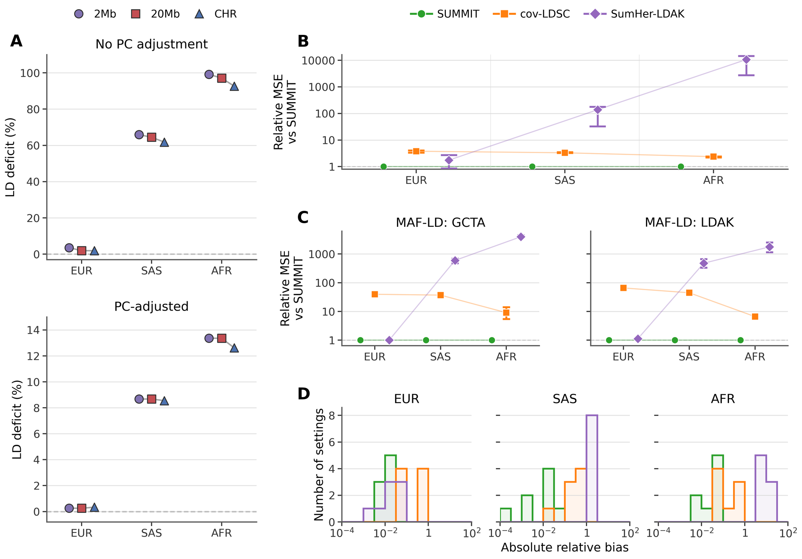
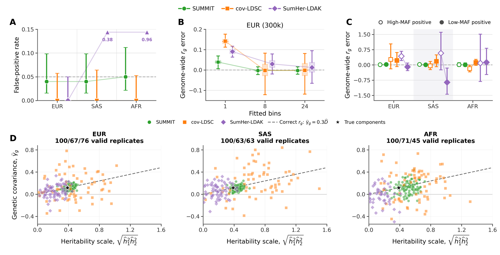
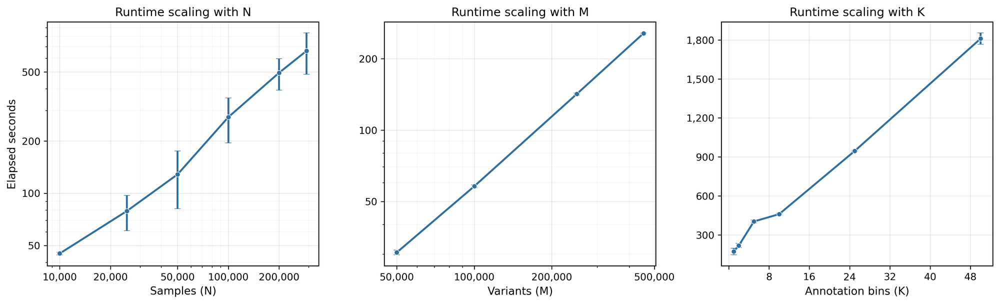

# Benchmarks

The measurements below describe specific tested workloads. Runtime depends on
panel size, annotations, context dimension, storage, and CPU configuration.
For estimated genetic variance in UK Biobank, see [Real-data results](Real-data-results.md).

## PGS synthetic benchmark

The PGS benchmark uses 2,048 generated samples and 4,096 variants, two trait
masks, ten models per trait, five context columns, and one CPU thread. Each
process performs setup, one warmup, and three operator repetitions.

| Genotype storage | Setup, seconds | Median operator, seconds | Process peak RSS, MiB |
|---|---:|---:|---:|
| Stream | 0.1738 | 0.3730 | 222.4 |
| Compact | 0.1780 | 0.3296 | 224.1 |
| Standardized FP64 | 0.1708 | 0.1788 | 261.1 |

These Linux measurements used pthread BLIS, SNP blocks of 256, and RHS width 64.
Peak RSS includes fixture generation. These timings measure covariance
operations. Full-cohort fitting time and memory require measurements on the
intended sample, variant panel, and candidate models.

Run each mode in a fresh process:

```bash
python scripts/prediction/checkout.py benchmark --mode stream --threads 1
python scripts/prediction/checkout.py benchmark --mode compact --threads 1
python scripts/prediction/checkout.py benchmark --mode standardized --threads 1
```

Cached modes read the source once during setup. Streaming reads it on every
operator call. Repeated outputs were identical in the recorded runs.

## Batch h² timing

A recorded four-trait comparison used 7,774,235 SNPs, 59 annotation columns,
chromosome jackknife, and four threads:

| Mode | Total wall time, seconds | Peak RSS, GB |
|---|---:|---:|
| Regular | 689.8 | 31.92 |
| Fast, uncached text | 724.8 | 32.03 |
| Fast, cached binary | 532.4 | 31.93 |

The 480 serialized component values differed by at most `2.7e-12`. Cached trait
processing took 6.43 seconds for four traits, but the common model load dominated
the end-to-end run. Uncached batching was not faster in this comparison.

## Accuracy in simulations

The SUMMIT preprint compared heritability and genetic correlation estimates
with cov-LDSC and SumHer-LDAK in simulations from UK Biobank genotypes of
participants of European, South Asian and African ancestry.



Panel A shows how much of the genome-wide LD windowed LD scores miss, with
and without PC adjustment. Panels B and C show the mean squared error of
heritability estimates relative to SUMMIT for single-component and MAF-LD
architectures, and panel D the distribution of absolute relative bias across
simulation settings.



Panel A shows the false-positive rate of genetic correlation tests under the
null, panels B and C the error of genome-wide rg estimates with partitioned
models, and panel D the estimated genetic covariance against the heritability
scale in each replicate.

## LD-score runtime



Genome-wide LD-score estimation time grows linearly with the number of
samples, variants and annotation bins. Later versions run phase 1 of the
calculation faster, so these times are upper bounds for the current code.

The preprint figures on this page are Figures 1 and 3 and Supplementary Figure S23 of [Jeong et al., bioRxiv (2026)](https://doi.org/10.64898/2026.10.20.760508), reproduced under [CC BY-NC-ND 4.0](https://creativecommons.org/licenses/by-nc-nd/4.0/), resized but
otherwise unmodified. These results come from the SUMMIT version used for the preprint, before LD scores computed with covariates carried the `V` column ([LD scores](LD-scores.md#covariates-and-snp-variance-weights)). With the current defaults, estimates in admixed cohorts are slightly higher.

## Measuring a new workload

Measure complete wall time through result writing and reload, peak RSS, and
input traversals. Compare estimates at the same solver tolerance or random-vector
count. For PGS, include held-out scoring; for randomized references, check more
than one seed and vector count before choosing analysis settings.
