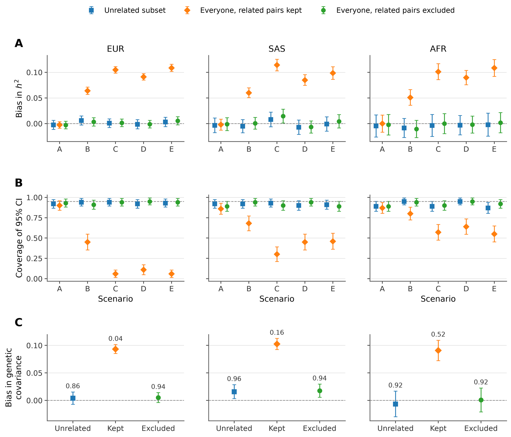
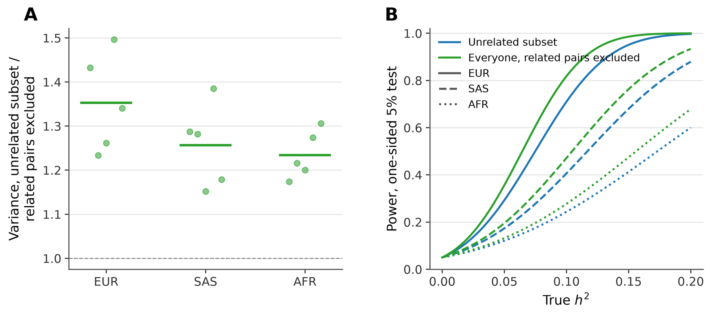

# Related individuals

SUMMIT's h² and rg estimators assume an unrelated GWAS sample. Close relatives
share untagged genetic variation and often environment, so including them
inflates the estimates. Pruning to an unrelated set avoids this but discards
people, which matters most in small or admixed cohorts.

This workflow keeps every individual and removes the related pairs from the
estimating equations instead. Run the GWAS on everyone as usual. SUMMIT then
computes the related pairs' part of each trait's association statistics,
`REL_M`, from the genotypes and phenotypes. By default this is one number per
trait, which is added to the summary statistics as a constant column and
subtracted by `summit --h2`. The estimate stays unbiased whatever the
phenotypic covariance between relatives.
[Methods](Methods.md#related-individuals) gives the estimating equations.

For a runnable synthetic example of the whole workflow (sibling pairs, h² and
rg), run `bash example/related_individuals.sh` from the repository root.

## Inputs

- The BED genotypes used for the GWAS. `summit relatives moments` does not yet read PGEN.
- A phenotype table with `FID IID` followed by one or more phenotype columns,
  as given to the GWAS.
- The GWAS covariates, `FID IID` followed by numeric columns, without an
  intercept column. Use exactly the covariates of the GWAS, including genotype PCs.
- A pair table with `IID1 IID2`, optionally `FID1 FID2` and a kinship column.
- GWAS summary statistics from ordinary least squares on all individuals with
  those covariates, for example PLINK 2 `--glm`. Mixed-model statistics
  (BOLT-LMM, REGENIE, fastGWA) are not valid inputs.

```text
IID1 IID2 RELATEDNESS
SIM000001 SIM000002 0.51
SIM000002 SIM000417 0.06
```

Listed pairs are closed into families (connected components) by default, and
every within-family pair is excluded. `--no-closure` excludes only the listed
pairs. With `--kinship-col` and `--kinship-min`, only pairs above the threshold
in that column are used. For relatedness (twice the kinship coefficient), 0.0442
keeps fourth-degree and closer relatives and is a reasonable default.

SUMMIT's PC-adjusted GRM on LD-pruned SNPs and PC-Relate give practically the
same families. KING-robust overstates kinship for individuals of intermediate
ancestry and should not define pairs in recently admixed cohorts. Compute PCs
on unrelated individuals and project relatives onto them (PC-AiR) so that
families do not form their own components.

## Compute related-pair moments

```bash
summit relatives moments \
  --geno study.bed --pheno phenotypes.tsv --covar covariates.tsv \
  --pairs pairs.tsv --kinship-col RELATEDNESS --kinship-min 0.0442 \
  --out results/relmoments
```

The command writes:

- `results/relmoments.rel_m.tsv`: one row per phenotype, `PHENO N N_COVARIATES
  PAIRS REL_M`, where `REL_M` is the related-pair moment per SNP in HE scale
  (the `V`-weighted mean over SNPs of the per-SNP moments). With
  `--annot annot.txt`, a partitioning annotation such as SUMMIT's MAF/LD bins,
  the table also has one `REL_M_<class>` column per class, for partitioned fits.
- `results/relmoments.json` and `results/relmoments.log`.

One genotype pass gives the values of every phenotype. Each phenotype keeps
its own complete-case sample, related pairs, covariate projection and `N_eff`,
as in a GWAS that drops missing values, and its values equal those computed
from the per-SNP moments of that sample. Missing genotypes are mean-imputed,
which agrees with complete-case GWAS to first order in the missing fraction.
The pass reads all genotypes but forms the projected genotypes only for people
in families, so its cost is mainly reading the genotypes, plus the number of
related pairs times the number of SNPs. `REL_M` does not depend on allele
coding.

One value per trait keeps the point estimate of the single-component model,
and of each class of the annotation used, exactly as with per-SNP values when
the LD scores come from the same sample (with LD scores from another sample,
the two differ only through the difference between the samples' `V` weights).
Only the jackknife changes, because each block's share of the total is then
proportional to its number of SNPs (weighted by `V`). In UK Biobank simulations
this moved standard errors by less than 0.1% ([Simulations](#simulations)).

`--per-snp` also writes the exact per-SNP values,
`results/relmoments.tsv.gz` (`CHR SNP BP A1 A2` and one `REL_M_<phenotype>`
column per phenotype). This needs one genotype pass per distinct complete-case
sample, and `append` and `cross-m12` accept the file in place of the
per-phenotype tables.

Add `--cross` to write `results/relmoments.rel_m12.tsv`, the cross-trait value
`REL_M12` for every pair of phenotypes with the same complete-case samples
(see [Genetic correlation](#genetic-correlation)).
When the LD scores are computed in the study itself, the LD-score step adds the
relatives' share (see [LD scores](#ld-scores)).

## Estimate h²

Add the column to the summary statistics and fit as usual:

```bash
summit relatives append --sumstats trait.sumstats.gz \
  --rel results/relmoments.rel_m.tsv --pheno TRAIT --out trait.rel.sumstats.gz

summit --h2 trait.rel.sumstats.gz --ldscores reference.gw.ldscore.gz \
  --out results/trait
```

`append` writes the trait's value in a `REL_M` column, the same for every SNP.
For a partitioned fit, run `moments` and `append` with the same `--annot`, and
each SNP gets its class's value. When a summary-statistics file has a `REL_M`
column, SUMMIT subtracts it from each SNP's HE-scale moment. Annotations,
partitioned models and every jackknife design work unchanged. The log reports
`c_rel` and the number of distinct `REL_M` values; SNPs with a missing `REL_M`
are dropped. `--h2-batch-fast` does not accept `REL_M`.

A study that releases summary statistics can add the constant `REL_M` column
itself, as it adds `COV_RANK`. Users then fit them with the related pairs
excluded and need nothing else, unless they compute LD scores in the same
sample.

## Inbreeding (optional)

Each individual is also paired with themselves in the h² estimating equation,
with the weight `K_ii`, the diagonal of the GRM. Inbred individuals have a
larger `K_ii`. When their residual variance is also larger, for example because
the effects of untagged causal variants grow with inbreeding, the fit credits
that excess to the SNPs. This happens in related and unrelated samples alike.
Add `--inbreeding` to `moments` to leave these diagonal terms out of the
equation as well, in the same way as the related pairs:

```bash
summit relatives moments --geno study --pheno phenotypes.txt --covar covariates.txt \
  --pairs pairs.tsv --kinship-col RELATEDNESS --kinship-min 0.0442 --inbreeding \
  --out results/relmoments
```

Nothing else changes. `append` copies three more values (`REL_S`, `REL_LAMBDA`
and `REL_DIAG`, plus one `REL_DIAG_<class>` column per class with `--annot`),
and `summit --h2` uses them whenever they are present. The log then says
"diagonal terms left out of the estimating equations". `REL_S` depends on the
phenotype; `REL_LAMBDA` and `REL_DIAG` depend only on the genotypes, the
covariates and the related pairs. The option also removes the small bias from
the related pairs' leverage on the covariates.

With LD scores computed exactly in the GWAS sample, the estimate equals the
individual-level method-of-moments estimate whose first equation uses only
pairs of different, unrelated individuals (tested to a relative difference of
1e-7). The cost is precision, because the diagonal terms also carry a little
information. In exact calculations for UK Biobank cohorts of 4,000 to 9,000
people (South Asian and African ancestry, 10 to 20 PCs), the standard deviation
of the estimate was 2% to 3% larger, and in a European cohort of 15,000 less
than 0.1% larger. The bias it removed in these cohorts was a few percent of the
standard error, about the same as this cost. The cost falls with sample size,
so the option is most useful in large samples with much inbreeding. The extra genotype pass projects the genotypes of everyone in each
complete-case sample, which adds roughly one GWAS-sized projection per sample.
For genetic correlation, run `moments` with `--cross --inbreeding`; `cross-m12`
then also writes `REL_S12`, the cross-trait value, and `summit --rg` leaves the
diagonal terms out of both h² fits and the cross-trait equations. This needs
the values in both summary-statistics files and in the `--rel-m12` file, and
the overlapping covariance in HE scale (`--pheno-rg`/`--pheno-rg-cov` or
`--overlap-covariance-rg`) rather than an estimated intercept, with the jackknife
or delta standard errors; SUMMIT stops with a message if any of these is missing. `--per-snp` works with `--inbreeding`
too: the run's `PREFIX.rel_m.tsv` and `PREFIX.rel_m12.tsv` hold the values,
and `append` and `cross-m12` read them next to the per-SNP table. LDSC
weighting (`--weight-mode ldsc`) runs on LD scores without the `V` column,
whereas these values are defined with it, so it refuses them.
A mean shift with inbreeding (inbreeding depression) is handled by adding an
inbreeding coefficient to the covariates of the GWAS, `moments` and the LD
scores.

The values from the default `moments` run are one number per phenotype (and
class), which gives exact point estimates but leaves the deleted block's
diagonal terms in every jackknife replicate. `moments --per-snp --inbreeding`
writes per-SNP values instead (one more genotype pass), `append` copies them,
and each replicate then uses its own diagonal terms (exactly for `REL_S` and
`REL_LAMBDA`, to first order in the deleted SNPs for `REL_DIAG`). In the test
data the jackknife SE then matched the exact replicate-wise SE to within 0.5%,
against 1% to 20% with one value per phenotype.

## Rescaled jackknife standard errors

The block jackknife cannot see covariance between blocks: long-range LD in
admixed samples, and the self-pair terms when self-relatedness tracks ancestry.
Under the fitted model both the variance of the estimate (`AV`) and the
expectation of the jackknife variance (`E[V_jk]`) are quadratic forms in
genotype-only traces of the jackknife blocks, so SUMMIT can rescale the
jackknife:

    SE = SE_jk * sqrt(AV / E[V_jk])

The jackknife keeps the variance it sees but the model misses (large-effect
loci, heavy-tailed traits); the factor adds what it cannot see. The traces come
from one genotype pass on the GWAS genotypes and samples:

```bash
summit relatives traces --geno study --covar covariates.txt --pairs pairs.tsv \
  --kinship-col RELATEDNESS --kinship-min 0.0442 [--annot mafld8.annot] [--inbreeding] --out results/traces
summit --h2 study.with_rel_m.tsv --ldscores study.gw.ldscore.gz [--annot ...] --jk-traces results/traces --out results/h2
```

Use the fit's annotation (one class per SNP) for partitioned fits; a
one-component fit can use traces with or without classes. `--inbreeding` adds
the traces without self-pairs, used automatically for fits with the
`moments --inbreeding` values. Cells are SUMMIT's 200 contiguous blocks split by
chromosome, so the same traces serve `--njack 200` and `--njack chr`; when the
fit's SNPs differ from the trace SNPs, cells are mapped to jackknife units by
SNP and the log gives the share of mismatched SNPs. The results table then has
`h2_se` (rescaled), `h2_se_jk` (the block jackknife) and `jk_factor`. The
pass holds the projected genotypes in memory (4 bytes per sample and SNP); with
100 probes it took about 5 minutes for 9,600 people and 406,000 SNPs (8 minutes
for 12,000 and 454,000) and about 15 to 20 minutes with 8 classes and 60
probes, on 16 cores. In UK Biobank simulations the rescaled SE was 0.93 to 1.06
of the empirical SD (one component) and 0.98 to 1.05 (8 classes) in every
cohort, against 0.68 for the block jackknife in a wide African-ancestry group.

## LD scores

| LD scores | Use when | Extra step |
|---|---|---|
| A matched reference, or the study's unrelated subset | The LD-score sample has the ancestry composition of the full GWAS sample | None |
| In-sample, on all GWAS individuals | Admixed or structured cohorts | Subtract the relatives' share |

In recently admixed cohorts, an unrelated subset chosen by kinship pruning can
have a different ancestry composition from the full cohort, and therefore
different admixture LD. Its LD scores then misstate the trace for the full
sample. In a UK Biobank admixed cohort this lowered h² by about 9%; in-sample
LD scores removed the bias.

In-sample LD scores include the relatives' pairs. Give the LD-score step the
same pairs and options as `moments`:

```bash
summit --geno study.bed --covar covariates.tsv \
  --relative-pairs pairs.tsv --kinship-col RELATEDNESS --kinship-min 0.0442 \
  --nvecs 20000 --block-size 16384 --num-threads 16 --out ld/study
```

`ld/study.gw.ldscore.gz` then has one `LD_REL_<column>` column per LD-score
column, holding the related pairs' share of that LD score. Fit with this file
as usual. `--h2` and `--rg` subtract LD_REL for summary
statistics with `REL_M` and use the LD scores unchanged otherwise; the log says
which. The LD-score step uses every sample with complete covariates, regardless
of phenotype missingness, and computes LD_REL with the same samples, covariates,
annotation and `V` weights as the LD scores. Partitioned LD scores need no
extra option, whatever the annotation. `--relative-pairs` reads BED or PGEN and
applies to genome-wide LD scores only.

An LD-score file without LD_REL columns is taken to come from unrelated
individuals.

## Genetic correlation

Pair exclusion must cover both h² denominators and the cross-trait moment:

```bash
summit relatives moments --geno study.bed --pheno phenotypes.tsv \
  --covar covariates.tsv --pairs pairs.tsv --cross --out results/relmoments
summit relatives append --sumstats a.sumstats.gz --rel results/relmoments.rel_m.tsv \
  --pheno A --out a.rel.sumstats.gz
summit relatives append --sumstats b.sumstats.gz --rel results/relmoments.rel_m.tsv \
  --pheno B --out b.rel.sumstats.gz
summit relatives cross-m12 --rel results/relmoments.rel_m12.tsv \
  --pheno1 A --pheno2 B --out a_b.relm12.tsv

summit --rg a.rel.sumstats.gz,b.rel.sumstats.gz --rel-m12 a_b.relm12.tsv \
  --ldscores reference.gw.ldscore.gz \
  --pheno-rg a.pheno.tsv,b.pheno.tsv --pheno-rg-cov covariates.tsv,covariates.tsv \
  --out results/a.b
```

`a_b.relm12.tsv` holds the pair's single `REL_M12` value. For a partitioned
fit, give `cross-m12` the annotation used in `moments` (`--annot`): the file
then holds each SNP's class value. `--rel-m12` also accepts the value itself,
or a per-SNP file from `--per-snp --cross`. SUMMIT
requires `REL_M` in both files and `--rel-m12`. With only some of them,
the pairs would be removed from some estimating equations and kept in others. With
in-sample LD scores that carry LD_REL, the same file serves h² and rg.
`REL_M12` exists only for phenotypes with identical complete-case samples.
The sample-overlap covariance describes each person's own two phenotypes and
needs no change. rg manifests do not accept `REL_M`.

## Simulations

We simulated phenotypes from UK Biobank genotypes in three cohorts that
include relatives, with families defined by GRM relatedness above 0.0442.

| Cohort | Individuals | Maximal unrelated subset | Within-family pairs | SNPs | PCs |
|---|---:|---:|---:|---:|---:|
| EUR | 14,561 | 12,151 | 4,216 | 454,207 | 10 |
| SAS | 8,566 | 7,484 | 2,506 | 448,403 | 20 |
| AFR | 4,327 | 3,903 | 721 | 1,002,034 | 10 |

Every SNP had an effect, except in scenario E, where 1% of SNPs did. The
heritability was 0.25, or 0.10 in scenario D. In scenarios B to E, relatives
also shared an untagged genetic component with variance 0.25 and covariance
proportional to their relatedness. In scenarios C to E they also shared
a household effect with variance 0.10. Scenario A had neither. Each scenario
had 100 replicates. The GWAS used PLINK 2 with the PCs as covariates, and
the summary statistics carried `COV_RANK`. Each analysis used in-sample LD
scores with the `V` column, computed in its own GWAS sample, and 200-block
jackknife standard errors. We compared the maximal unrelated subset with
everyone, keeping or excluding the related pairs. The truth is the simulated
heritability.



Excluding related pairs gave unbiased estimates in every cohort and scenario
(panel A), and so did the unrelated subset. Keeping the related pairs biased
h² upward by 0.05 to 0.11 whenever relatives shared more than the SNP
kernel. Confidence intervals from excluding pairs covered the truth in 89% to
95% of replicates (panel B). Coverage was lowest in the admixed AFR cohort,
where jackknife standard errors are somewhat small.

For genetic correlation we simulated 50 pairs of traits per cohort with
h² 0.25 and rg 0.5, in which relatives also shared correlated untagged and
household effects. The overlap covariance came from `--pheno-rg` and
`--pheno-rg-cov`, and the pair-excluded fits used `REL_M` in both files and
`--rel-m12`. Excluding related pairs estimated the genetic covariance as well
as the unrelated subset did, and keeping them inflated it by 0.09 to 0.10
(panel C; labels give the coverage of 95% intervals).



Keeping everyone made the estimates more precise. The sampling variance of
the unrelated-subset estimate was 1.15 to 1.50 times that of the
pair-excluded estimate (panel A), a mean of 1.35 in EUR, 1.26 in SAS and 1.23
in AFR, where 17%, 13% and 10% of individuals were outside the unrelated
subset. Panel B shows the power to detect heritability at the 5% level
implied by each analysis's sampling variance.

The simulations used per-SNP `REL_M`. Refitting every pair-excluded analysis
with one value per trait (the default) left the h² and rg estimates unchanged.
It moved the jackknife standard errors by +0.01% to +0.09% on average (0.993 to
1.009 times the per-SNP standard error in individual fits) and left coverage
unchanged in every cohort and scenario. The genetic-covariance standard errors
moved by +0.08% to +0.10%. A second approximation, which spread each total in
proportion to a genotype-only per-SNP sum over the related pairs, did no better.

In AFR, the same pair-excluded analysis with ordinary LD scores
(`--snp-var-weights-off`) underestimated h² by 0.010 to 0.023 because the PCs
explain part of the genotype variance
([LD scores](LD-scores.md#covariates-and-snp-variance-weights)).

The simulation and plotting scripts are in
`benchmarks/related_individuals/`.

## Interpretation

The estimate is the SNP heritability of the SNPs in the GRM, the quantity
SUMMIT estimates in unrelated samples. Covariance between relatives from
shared environment or untagged variants is removed with their pairs, whatever
its form. Pairs below the threshold remain; their contribution scales with their
squared relatedness and is small for distant relatives.

Jackknife standard errors are computed as for unrelated samples. With one
`REL_M` value per trait, a deleted block removes the related pairs' part in
proportion to its SNPs rather than its own part; the simulations below compare
both.

A single `REL_M` value per trait is a weighted sum of phenotype products over
all related pairs and reveals little about any one pair. Per-SNP values
computed from few pairs carry information about those individuals' genotypes
and phenotypes. Keep `--per-snp` output in the secure environment where it was
computed. Binary traits (PCGC) are not covered.
